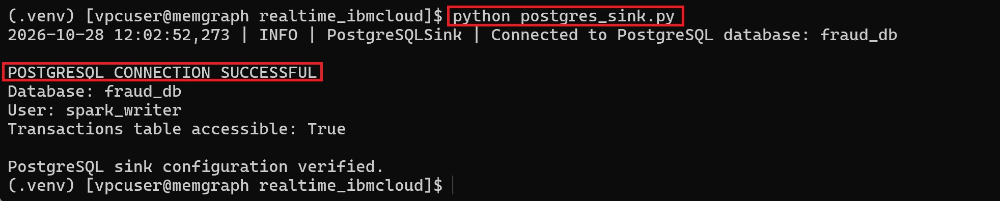
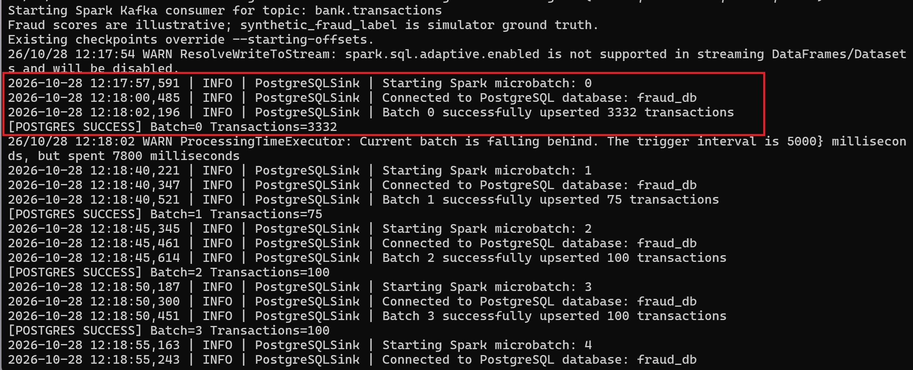
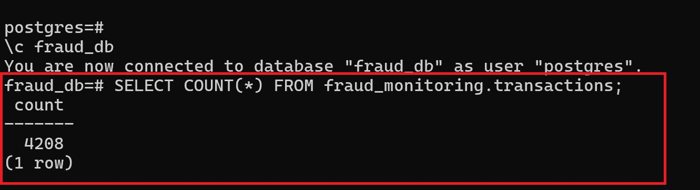

# Real-time-Fraud-Monitoring
Real time fraud monitoring on IBM Cloud

<H3>Reference Architecture</H3>

```text
                    SYNTHETIC BANKING TRANSACTIONS
                         Python Fraud Simulator
                      Cards | UPI | Online Banking
                                    |
                                    | JSON Events
                                    v
                         IBM EVENT STREAMS
                            Apache Kafka
                                    |
                         Topic: bank.transactions
                                    |
                                    v
                       APACHE SPARK STREAMING
                        Fraud Detection Engine
                                    |
                      +-------------+-------------+
                      |                           |
                      v                           v
                Fraud Rules                 Aggregations
              Risk Score 0–100           Merchant / Region
                      |                           |
                      +-------------+-------------+
                                    |
                                    v
                           PostgreSQL
                       Fraud Analytics Tables
                                    |
                                    v
                           APACHE SUPERSET
                         Monitoring Dashboards
                                    |
                     +--------------+--------------+
                     |              |              |
                 Fraud Rate    Risk by Region   High-Risk
                                                Merchants

             OPTIONAL HISTORICAL LAKEHOUSE PATH

                     Spark Structured Streaming
                                    |
                                    v
                         Apache Iceberg Tables
                                    |
                                    v
                       IBM Cloud Object Storage
                                    |
                                    v
                          IBM watsonx.data
                         Historical Analytics
```

<h3>Create Code folder</h3>

```python
mkdir realtime_ibmcloud

Copy code in this directory.

sudo mkdir -p /home/vpcuser/realtime_ibmcloud/checkpoints/fraud_consumer
sudo chown -R vpcuser:vpcuser \
  /home/vpcuser/realtime_ibmcloud/checkpoints
sudo chmod -R u+rwX \
  /home/vpcuser/realtime_ibmcloud/checkpoints

Verify write access:
touch ~/realtime_ibmcloud/checkpoints/fraud_consumer/.write_test \
  && rm ~/realtime_ibmcloud/checkpoints/fraud_consumer/.write_test \
  && echo "Checkpoint directory writable"
  
```

<H3>Install the Python dependencies:</H3>
```python
python3 -m venv .venv
source .venv/bin/activate
pip install -r requirements.txt
```

Generate five sample transactions without connecting to IBM Cloud:

```python
python simulator.py --dry-run --count 5
```


This generates approximately 20 transactions per second, with 8% assigned synthetic fraud labels.

The Spark pipeline then processes the transactions and stores scored results for Superset.

<H3>Step 2: Configure IBM Event Streams</H3>

Use your existing Event Streams instance.

Create or confirm the Kafka topic:

<pre><code>bank.transactions</code></pre>

The simulator must use the broker endpoints and **SASL/TLS** authentication settings from your **Event Streams service** credentials.

For IBM Event Streams on IBM Cloud, the usual Kafka authentication mechanism is **SASL_SSL with PLAIN**, using the **API key as the password**. The username is typically token.

Keep credentials in your local **.env** file and never commit them to Git.


<H3>Step 3: Start the simulator</H3>

Once credentials and topic configuration are validated:

```python
python simulator.py --rate 20 --fraud-rate 0.08
```


Test with <a href="https://github.com/sharadc2001/Real-time-Fraud-Monitoring/blob/main/code/spark_consumer.py">spark_consumer.py</a>

```python
spark-submit \
  --master "local[4]" \
  --packages org.apache.spark:spark-sql-kafka-0-10_2.13:4.0.4 \
  spark_consumer.py \
  --starting-offsets earliest
```


The consumer should print micro-batches containing transaction identifiers, amounts, fraud scores, risk levels, and other transaction attributes.

```text
A successful test confirms that:
- Python publishes synthetic transactions to IBM Event Streams.
- Spark reads the Kafka topic.
- Spark parses transaction JSON.
- Fraud scoring produces values between 0 and 100.
- Transactions are classified into LOW, MEDIUM, and HIGH risk.
- Spark resumes from its checkpoint after restarting.
```
<H3>Create Database Objects</H3>

```text
| PostgreSQL user   | Purpose                    | Permissions            | 
|-------------------|----------------------------|------------------------|
| `postgres`        | Database administration    | Superuser              |
| `spark_writer`    | Spark Structured Streaming | SELECT, INSERT, UPDATE |
| `superset_reader` | Apache Superset dashboards | SELECT only            |
```

<H3>Create the spark writer user</H3>

```sql
CREATE ROLE spark_writer
WITH LOGIN PASSWORD 'REPLACE_WITH_STRONG_UNIQUE_PASSWORD';

GRANT CONNECT ON DATABASE fraud_db TO spark_writer;

GRANT USAGE ON SCHEMA fraud_monitoring TO spark_writer;

GRANT SELECT, INSERT, UPDATE
ON fraud_monitoring.transactions
TO spark_writer;
```

<H3>Create the Superset read-only user</H3>

```sql
CREATE ROLE superset_reader
WITH LOGIN PASSWORD 'REPLACE_WITH_ANOTHER_STRONG_PASSWORD';

GRANT CONNECT ON DATABASE fraud_db TO superset_reader;

GRANT USAGE ON SCHEMA fraud_monitoring TO superset_reader;

GRANT SELECT ON
    fraud_monitoring.transactions,
    fraud_monitoring.fraud_alerts,
    fraud_monitoring.merchant_risk_summary,
    fraud_monitoring.vw_fraud_dashboard,
    fraud_monitoring.vw_high_risk_transactions
TO superset_reader;

```

<H3>Configure permissions for future tables</H3>

```sql
ALTER DEFAULT PRIVILEGES FOR ROLE postgres
IN SCHEMA fraud_monitoring
GRANT SELECT ON TABLES TO superset_reader;

ALTER DEFAULT PRIVILEGES FOR ROLE postgres
IN SCHEMA fraud_monitoring
GRANT SELECT, INSERT, UPDATE ON TABLES TO spark_writer;

```

<H3>Create Database</H3>

```sql
CREATE DATABASE fraud_db;
CREATE SCHEMA IF NOT EXISTS fraud_monitoring;
```

<H3>Create Transaction Table</H3>

```sql

CREATE TABLE IF NOT EXISTS fraud_monitoring.transactions (
    transaction_id UUID PRIMARY KEY,
    event_time TIMESTAMPTZ NOT NULL,
    customer_id VARCHAR(100),
    account_id VARCHAR(100),
    merchant_id VARCHAR(100),
    merchant_category VARCHAR(100),
    channel VARCHAR(50),
    amount_inr NUMERIC(18,2) NOT NULL,
    currency VARCHAR(10) DEFAULT 'INR',
    city VARCHAR(100),
    country VARCHAR(10),
    device_id VARCHAR(100),
    is_new_device BOOLEAN,
    synthetic_fraud_label BOOLEAN DEFAULT FALSE,
    synthetic_scenario VARCHAR(100),
    fraud_score INTEGER NOT NULL DEFAULT 0
        CHECK (fraud_score BETWEEN 0 AND 100),
    risk_level VARCHAR(20) NOT NULL DEFAULT 'LOW'
        CHECK (risk_level IN ('LOW', 'MEDIUM', 'HIGH')),
    schema_version INTEGER DEFAULT 1,
    processed_at TIMESTAMPTZ DEFAULT CURRENT_TIMESTAMP
);

```

<H3>Create the fraud alerts table</H3>

```sql

CREATE TABLE IF NOT EXISTS fraud_monitoring.fraud_alerts (
    alert_id BIGSERIAL PRIMARY KEY,
    transaction_id UUID NOT NULL UNIQUE
        REFERENCES fraud_monitoring.transactions(transaction_id),
    customer_id VARCHAR(100),
    fraud_score INTEGER,
    risk_level VARCHAR(20),
    alert_reason TEXT,
    alert_status VARCHAR(30) DEFAULT 'OPEN',
    created_at TIMESTAMPTZ DEFAULT CURRENT_TIMESTAMP,
    resolved_at TIMESTAMPTZ
);

```

<H3>Create merchant risk summary</H3>

```sql

CREATE TABLE IF NOT EXISTS fraud_monitoring.merchant_risk_summary (
    merchant_id VARCHAR(100) PRIMARY KEY,
    total_transactions BIGINT DEFAULT 0,
    suspicious_transactions BIGINT DEFAULT 0,
    total_transaction_amount NUMERIC(20,2) DEFAULT 0,
    suspicious_amount NUMERIC(20,2) DEFAULT 0,
    average_fraud_score NUMERIC(8,2) DEFAULT 0,
    last_updated TIMESTAMPTZ DEFAULT CURRENT_TIMESTAMP
);

```

<H3>Create indexes</H3>

```sql

CREATE INDEX IF NOT EXISTS idx_transactions_event_time
ON fraud_monitoring.transactions(event_time DESC);

CREATE INDEX IF NOT EXISTS idx_transactions_risk_level
ON fraud_monitoring.transactions(risk_level);

CREATE INDEX IF NOT EXISTS idx_transactions_customer
ON fraud_monitoring.transactions(customer_id);

CREATE INDEX IF NOT EXISTS idx_transactions_merchant
ON fraud_monitoring.transactions(merchant_id);

CREATE INDEX IF NOT EXISTS idx_alerts_status
ON fraud_monitoring.fraud_alerts(alert_status);

```

<H3>Create the fraud dashboard view</H3>

```sql

CREATE OR REPLACE VIEW fraud_monitoring.vw_fraud_dashboard AS
SELECT
    DATE_TRUNC('minute', event_time) AS transaction_minute,
    COUNT(*) AS total_transactions,

    COUNT(*) FILTER (
        WHERE risk_level = 'HIGH'
    ) AS high_risk_transactions,

    COUNT(*) FILTER (
        WHERE risk_level = 'MEDIUM'
    ) AS medium_risk_transactions,

    COUNT(*) FILTER (
        WHERE risk_level = 'LOW'
    ) AS low_risk_transactions,

    COUNT(*) FILTER (
        WHERE synthetic_fraud_label = TRUE
    ) AS simulated_fraud_transactions,

    SUM(amount_inr) AS total_transaction_amount,
    AVG(fraud_score) AS average_fraud_score

FROM fraud_monitoring.transactions
GROUP BY DATE_TRUNC('minute', event_time);

```

<H3>Create the high-risk transactions view</H3>

```sql

CREATE OR REPLACE VIEW fraud_monitoring.vw_high_risk_transactions AS
SELECT
    transaction_id,
    event_time,
    customer_id,
    merchant_id,
    merchant_category,
    channel,
    amount_inr,
    city,
    country,
    fraud_score,
    risk_level,
    synthetic_fraud_label,
    synthetic_scenario
FROM fraud_monitoring.transactions
WHERE risk_level = 'HIGH';

```
<H3>Switch to the correct database</H3>

```sql

\c fraud_db

```

<H3>Verify your tables and views</H3>

```sql

\dt fraud_monitoring.*

\dv fraud_monitoring.*

```

| File            | Responsibility                                                                                |
|-----------------|-----------------------------------------------------------------------------------------------|
| `spark_consumer.py` | Reads Kafka transactions, calculates fraud scores, and manages Spark Structured Streaming |
| `postgres_sink.py`  | Receives processed Spark batches and inserts them into PostgreSQL                         |

Now the database is configured, with <a href="https://github.com/sharadc2001/Real-time-Fraud-Monitoring/blob/main/code/postgres_sink.py">postgres_sink.py</a>

```python
spark-submit \
  --master "local[4]" \
  --packages \
org.apache.spark:spark-sql-kafka-0-10_2.13:4.0.4,org.postgresql:postgresql:42.7.8 \
  spark_consumer.py \
  --starting-offsets earliest

```

Install postgres python driver

```python
python -m pip install psycopg2-binary
```

Then test the database connection:



<H3>Test the code</H3>

Output from Spark



Check Database tables


<H2>Dashboarding with Apache Superset</H2>

```text
Open your Apache Superset web interface.

Navigate to:

Settings → Database Connections → + Database

Depending on your Superset version, this may appear under Data → Databases.

```
Enter the following information:

```text
| Field        | Value                         |
|--------------|-------------------------------|
| Display Name | Fraud Monitoring PostgreSQL   |
| Host         | PostgreSQL server hostname/IP |
| Port         | 5432                          |
| Database     | fraud_db                      |
| Username     | superset_reader               |
| Password     | Your PostgreSQL password      |

```
Click Test Connection, then Connect or Save.

If Superset reports that the PostgreSQL driver is missing, install psycopg2 in the Superset application environment.

<H3>Register PostgreSQL datasets</H3>

```text

Navigate to:

Datasets → + Dataset

Select:
- Database: Fraud Monitoring PostgreSQL
- Schema: fraud_monitoring
- Table: transactions

Click Create Dataset.

```

Repeat for these datasets:

```text

| Dataset                     | Purpose                                  |
|-----------------------------|------------------------------------------|
| `transactions`              | All processed banking transactions       |
| `vw_fraud_dashboard`        | Aggregated transaction and fraud metrics |
| `vw_high_risk_transactions` | High-risk transaction investigation      |
| `fraud_alerts`              | Fraud alerts, once populated             |
| `merchant_risk_summary`     | Merchant analytics, once populated       |

```


For now, prioritize transactions and vw_fraud_dashboard. Your current Spark writer populates the transaction table; the alert and merchant summary tables may still be empty.

<H3>Create your first dashboard</H3>

```text
Navigate to:

Dashboards → + Dashboard

Set the name to:

Real-Time Banking Fraud Monitoring | IBM Cloud

I recommend arranging the dashboard into four sections.

```

**Section A — Transaction monitoring KPIs**

Create four KPI charts using the transactions dataset.

```text
| KPI                     | Superset chart | Metric                                  |
|-------------------------|----------------|-----------------------------------------|
| Total Transactions      | Big Number     | `COUNT(*)`                              |
| High-Risk Transactions  | Big Number     | Count filtered to `risk_level = 'HIGH'` |
| Total Transaction Value | Big Number     | `SUM(amount_inr)`                       |
| Average Fraud Score     | Big Number     | `AVG(fraud_score)`                      |
```

**Create the first KPI**

```text
Navigate to Charts → + Chart.

Select:

Dataset: fraud_monitoring.transactions

Chart type: Big Number

Configure:

Metric: COUNT(*)
Time Column: event_time
Time Range: Last 24 hours

Name the chart:

Total Transactions

Click Run, then Save.

Add it to your new dashboard.

Repeat for the other three metrics.

```

<H3>Create fraud-risk visualizations</H3>

**Chart 1 — Fraud risk distribution**

```text

Chart type: ECharts Pie Chart or Donut Chart

Dataset: transactions

Configure:
Dimension: risk_level
Metric: COUNT(*)

Expected categories:
- LOW
- MEDIUM
- HIGH

This chart shows the proportion of transactions assigned to each risk category.

```

**Chart 2 — Transaction throughput over time**

```text

Chart type: Time-series Line Chart

Dataset: transactions

Configure:
 Time Column: event_time
 Time Grain: Minute
 Metric: COUNT(*)
 Time Range: Last 1 hour

This chart helps you monitor the transaction rate entering PostgreSQL.

For example, if the simulator generates 20 transactions per second, the chart should reflect approximately 1,200 transactions per minute under steady-state conditions, assuming successful ingestion and no duplicates. This is a theoretical rate, not a measured result.

```

**Chart 3 — High-risk transactions by city**

```text

Chart type: Bar Chart

Configure:
  X-Axis: city
  Metric: COUNT(*)
  Filter: risk_level = 'HIGH'
  Sort: Descending

This helps identify locations with high volumes of suspicious transactions.

Remember that transaction volume alone does not establish a higher fraud rate; for that, divide high-risk transactions by total transactions per city.

```

**Chart 4 — Top merchants by fraud score**

```text

Chart type: Bar Chart

Configure:
  X-Axis: merchant_id
  Metric: AVG(fraud_score)
  Sort: Descending
  Row Limit: 10

This shows merchants associated with higher average transaction risk.

For more reliable comparisons, add a minimum transaction-count filter.

```

**Phase 5 — Create a fraud investigation table**

```text

This is one of the most useful components of the dashboard.

Chart type: Table

Dataset: transactions

Select these columns:

transaction_id
event_time
customer_id
merchant_id
channel
amount_inr
city
country
fraud_score
risk_level
synthetic_fraud_label
synthetic_scenario

Configure:

Sort By: event_time
Sort Descending: Yes
Row Limit: 100

Name it:

Recent Banking Transactions

Create a second table filtered by:

risk_level = 'HIGH'

Name it:

High-Risk Transaction Investigation

This gives you a practical monitoring interface for examining suspicious activity.

```


**Phase 6 — Add advanced SQL-based analytics**

```text

Superset's SQL Lab can help you build additional datasets.

Navigate to:

SQL → SQL Lab

Select your PostgreSQL connection and fraud_monitoring schema.

```

**Query 1 — Overall fraud monitoring statistics**

```sql
SELECT
    COUNT(*) AS total_transactions,

    COUNT(*) FILTER (
        WHERE risk_level = 'HIGH'
    ) AS high_risk_transactions,

    COUNT(*) FILTER (
        WHERE risk_level = 'MEDIUM'
    ) AS medium_risk_transactions,

    COUNT(*) FILTER (
        WHERE risk_level = 'LOW'
    ) AS low_risk_transactions,

    ROUND(AVG(fraud_score), 2) AS average_fraud_score,

    ROUND(SUM(amount_inr), 2) AS total_transaction_value

FROM fraud_monitoring.transactions;

```

**Query 2 — Fraud-risk trend per minute**

```sql
SELECT
    DATE_TRUNC('minute', event_time) AS minute,

    COUNT(*) AS total_transactions,

    COUNT(*) FILTER (
        WHERE risk_level = 'HIGH'
    ) AS high_risk_transactions,

    ROUND(AVG(fraud_score), 2) AS average_fraud_score

FROM fraud_monitoring.transactions

WHERE event_time >= NOW() - INTERVAL '1 hour'

GROUP BY DATE_TRUNC('minute', event_time)

ORDER BY minute DESC;

```

**Query 3 — High-risk merchants**

```sql
SELECT
    merchant_id,

    COUNT(*) AS total_transactions,

    COUNT(*) FILTER (
        WHERE risk_level = 'HIGH'
    ) AS high_risk_transactions,

    ROUND(AVG(fraud_score), 2) AS average_fraud_score,

    ROUND(SUM(amount_inr), 2) AS transaction_value

FROM fraud_monitoring.transactions

GROUP BY merchant_id

HAVING COUNT(*) >= 5

ORDER BY high_risk_transactions DESC

LIMIT 10;

```

**Query 4 — Fraud detection against synthetic ground truth**

Because your simulator generates synthetic_fraud_label, you can evaluate the rule-based scoring engine.

```sql
SELECT
    COUNT(*) FILTER (
        WHERE synthetic_fraud_label = TRUE
          AND risk_level = 'HIGH'
    ) AS true_positives,

    COUNT(*) FILTER (
        WHERE synthetic_fraud_label = FALSE
          AND risk_level = 'HIGH'
    ) AS false_positives,

    COUNT(*) FILTER (
        WHERE synthetic_fraud_label = TRUE
          AND risk_level <> 'HIGH'
    ) AS false_negatives,

    COUNT(*) FILTER (
        WHERE synthetic_fraud_label = FALSE
          AND risk_level <> 'HIGH'
    ) AS true_negatives

FROM fraud_monitoring.transactions

WHERE synthetic_fraud_label IS NOT NULL;

```

This treats HIGH as the positive prediction. You can later calculate precision, recall, and F1-score.

**Important:** These results evaluate your scoring rules against simulated labels, not real-world banking fraud performance.


**Phase 7 — Enable near-real-time dashboard refresh**

Since Spark continuously inserts records into PostgreSQL, configure your dashboard to refresh periodically.

Open your dashboard and look for the Auto-refresh or Refresh frequency control.

Depending on your Superset version and configuration, you may be able to choose intervals such as:

| Refresh interval | Use case                       |
|------------------|--------------------------------|
| 10 seconds       | Demonstration, if supported    |
| 30 seconds       | Near-real-time monitoring      |
| 1 minute         | General operational monitoring |
| 5 minutes        | Historical analytics           |

I recommend starting with 30 seconds, if your installation supports it.

Superset uses periodic queries rather than directly consuming Kafka events, so the dashboard is near-real-time rather than truly event-driven.

Also check that Superset's chart caching settings do not prevent fresh results from appearing.


<H1>Simple Use Case</H1>

**Chart 1: Transactions in the Last 5 Minutes**

Use your existing fraud_monitoring.transactions table.

SQL Lab query:

```sql
SELECT
    COUNT(*) AS transactions_last_5_minutes
FROM fraud_monitoring.transactions
WHERE event_time >= NOW() - INTERVAL '5 minutes';
```

Superset chart: Big Number

Save the SQL query as a virtual dataset, then create a **Big Number** chart using **MAX(transactions_last_5_minutes)** as its metric.


**Chart 2: Transactions per Minute**

SQL Lab query:

```sql
SELECT
    DATE_TRUNC('minute', event_time) AS transaction_minute,
    COUNT(*) AS transaction_count
FROM fraud_monitoring.transactions
WHERE event_time >= NOW() - INTERVAL '15 minutes'
GROUP BY 1
ORDER BY 1;

```

**Superset chart: Time-series Line Chart**

Save this query as a virtual dataset and configure:

| Setting           | Value                           |
|-------------------|---------------------------------|
| Time column       | `transaction_minute`            |
| Time grain        | Minute                          |
| Metric            | `SUM(transaction_count)`        |
| Time range        | No filter                       |
| Dashboard refresh | 10 seconds, if supported        |

Use a No filter chart-level time range because the SQL query already applies a rolling 15-minute window. Otherwise, additional time filtering may interfere with the intended results.

For both charts, disable or minimize query-result caching during the lab test so refreshes return current data.

<H3>How to demonstrate it</H3>

Run your existing transaction simulator and Spark consumer, then open the Superset dashboard.

Observe the two charts updating as transactions arrive. Stop the simulator and demonstrate how the transaction count declines as older events leave the five-minute window.

This provides a straightforward demonstration of continuous ingestion and near-real-time reporting.


