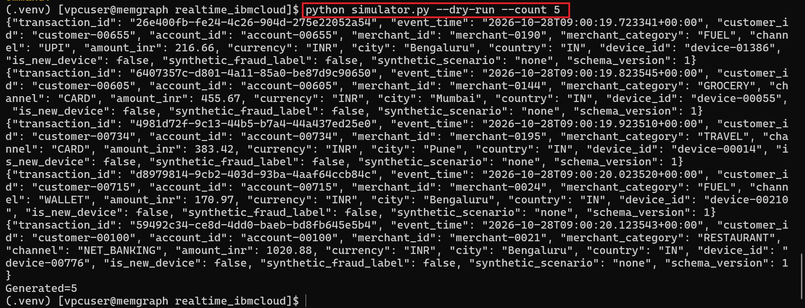
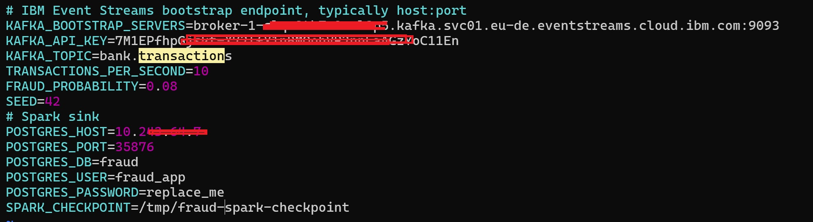
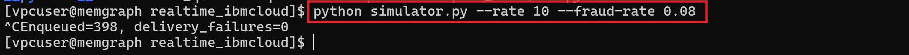
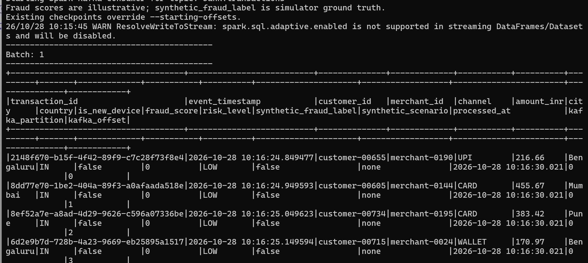

# Real-time-Fraud-Monitoring
Real time fraud monitoring on IBM Cloud

<H3>Reference Architecture</H3>

```text
                    SYNTHETIC BANKING TRANSACTIONS
                         Python Fraud Simulator
                      Cards | UPI | Online Banking
                                    |
                                    | JSON Events
                                    v
                         IBM EVENT STREAMS
                            Apache Kafka
                                    |
                         Topic: bank.transactions
                                    |
                                    v
                       APACHE SPARK STREAMING
                        Fraud Detection Engine
                                    |
                      +-------------+-------------+
                      |                           |
                      v                           v
                Fraud Rules                 Aggregations
              Risk Score 0–100           Merchant / Region
                      |                           |
                      +-------------+-------------+
                                    |
                                    v
                           PostgreSQL
                       Fraud Analytics Tables
                                    |
                                    v
                           APACHE SUPERSET
                         Monitoring Dashboards
                                    |
                     +--------------+--------------+
                     |              |              |
                 Fraud Rate    Risk by Region   High-Risk
                                                Merchants

             OPTIONAL HISTORICAL LAKEHOUSE PATH

                     Spark Structured Streaming
                                    |
                                    v
                         Apache Iceberg Tables
                                    |
                                    v
                       IBM Cloud Object Storage
                                    |
                                    v
                          IBM watsonx.data
                         Historical Analytics
```

<h3>Create Code folder</h3>
```python
mkdir realtime_ibmcloud

Copy code in this directory.

sudo mkdir -p /home/vpcuser/realtime_ibmcloud/checkpoints/fraud_consumer
sudo chown -R vpcuser:vpcuser \
  /home/vpcuser/realtime_ibmcloud/checkpoints
sudo chmod -R u+rwX \
  /home/vpcuser/realtime_ibmcloud/checkpoints

Verify write access:
touch ~/realtime_ibmcloud/checkpoints/fraud_consumer/.write_test \
  && rm ~/realtime_ibmcloud/checkpoints/fraud_consumer/.write_test \
  && echo "Checkpoint directory writable"
  
```

<H3>Install the Python dependencies:</H3>
```python
python3 -m venv .venv
source .venv/bin/activate
pip install -r requirements.txt
```

Generate five sample transactions without connecting to IBM Cloud:

```python
python simulator.py --dry-run --count 5
```




This generates approximately 20 transactions per second, with 8% assigned synthetic fraud labels.

The Spark pipeline then processes the transactions and stores scored results for Superset.

<H3>Step 2: Configure IBM Event Streams</H3>

Use your existing Event Streams instance.

Create or confirm the Kafka topic:

<pre><code>bank.transactions</code></pre>

The simulator must use the broker endpoints and **SASL/TLS** authentication settings from your **Event Streams service** credentials.

For IBM Event Streams on IBM Cloud, the usual Kafka authentication mechanism is **SASL_SSL with PLAIN**, using the **API key as the password**. The username is typically token.

Keep credentials in your local **.env** file and never commit them to Git.



<H3>Step 3: Start the simulator</H3>

Once credentials and topic configuration are validated:

```python
python simulator.py --rate 20 --fraud-rate 0.08
```



Test with Spark consumer:

```python
spark-submit \
  --master "local[4]" \
  --packages org.apache.spark:spark-sql-kafka-0-10_2.13:4.0.4 \
  spark_consumer.py \
  --starting-offsets earliest
```



The consumer should print micro-batches containing transaction identifiers, amounts, fraud scores, risk levels, and other transaction attributes.

```text
A successful test confirms that:
- Python publishes synthetic transactions to IBM Event Streams.
- Spark reads the Kafka topic.
- Spark parses transaction JSON.
- Fraud scoring produces values between 0 and 100.
- Transactions are classified into LOW, MEDIUM, and HIGH risk.
- Spark resumes from its checkpoint after restarting.
```
<H3>Create Database Objects</H3>

```text
| PostgreSQL user   | Purpose                    | Permissions            | 
|-------------------|----------------------------|------------------------|
| `postgres`        | Database administration    | Superuser              |
| `spark_writer`    | Spark Structured Streaming | SELECT, INSERT, UPDATE |
| `superset_reader` | Apache Superset dashboards | SELECT only            |
```

<H3>Create the spark writer user</H3>

```sql
CREATE ROLE spark_writer
WITH LOGIN PASSWORD 'REPLACE_WITH_STRONG_UNIQUE_PASSWORD';

GRANT CONNECT ON DATABASE fraud_db TO spark_writer;

GRANT USAGE ON SCHEMA fraud_monitoring TO spark_writer;

GRANT SELECT, INSERT, UPDATE
ON fraud_monitoring.transactions
TO spark_writer;
```

<H3>Create the Superset read-only user</H3>

```sql
CREATE ROLE superset_reader
WITH LOGIN PASSWORD 'REPLACE_WITH_ANOTHER_STRONG_PASSWORD';

GRANT CONNECT ON DATABASE fraud_db TO superset_reader;

GRANT USAGE ON SCHEMA fraud_monitoring TO superset_reader;

GRANT SELECT ON
    fraud_monitoring.transactions,
    fraud_monitoring.fraud_alerts,
    fraud_monitoring.merchant_risk_summary,
    fraud_monitoring.vw_fraud_dashboard,
    fraud_monitoring.vw_high_risk_transactions
TO superset_reader;

```

<H3>Configure permissions for future tables</H3>

```sql
ALTER DEFAULT PRIVILEGES FOR ROLE postgres
IN SCHEMA fraud_monitoring
GRANT SELECT ON TABLES TO superset_reader;

ALTER DEFAULT PRIVILEGES FOR ROLE postgres
IN SCHEMA fraud_monitoring
GRANT SELECT, INSERT, UPDATE ON TABLES TO spark_writer;

```

<H3>Create Database</H3>

```sql
CREATE DATABASE fraud_db;
CREATE SCHEMA IF NOT EXISTS fraud_monitoring;
```

<H3>Create Transaction Table</H3>

```sql

CREATE TABLE IF NOT EXISTS fraud_monitoring.transactions (
    transaction_id UUID PRIMARY KEY,
    event_time TIMESTAMPTZ NOT NULL,
    customer_id VARCHAR(100),
    account_id VARCHAR(100),
    merchant_id VARCHAR(100),
    merchant_category VARCHAR(100),
    channel VARCHAR(50),
    amount_inr NUMERIC(18,2) NOT NULL,
    currency VARCHAR(10) DEFAULT 'INR',
    city VARCHAR(100),
    country VARCHAR(10),
    device_id VARCHAR(100),
    is_new_device BOOLEAN,
    synthetic_fraud_label BOOLEAN DEFAULT FALSE,
    synthetic_scenario VARCHAR(100),
    fraud_score INTEGER NOT NULL DEFAULT 0
        CHECK (fraud_score BETWEEN 0 AND 100),
    risk_level VARCHAR(20) NOT NULL DEFAULT 'LOW'
        CHECK (risk_level IN ('LOW', 'MEDIUM', 'HIGH')),
    schema_version INTEGER DEFAULT 1,
    processed_at TIMESTAMPTZ DEFAULT CURRENT_TIMESTAMP
);

```

<H3>Create the fraud alerts table</H3>

```sql

CREATE TABLE IF NOT EXISTS fraud_monitoring.fraud_alerts (
    alert_id BIGSERIAL PRIMARY KEY,
    transaction_id UUID NOT NULL UNIQUE
        REFERENCES fraud_monitoring.transactions(transaction_id),
    customer_id VARCHAR(100),
    fraud_score INTEGER,
    risk_level VARCHAR(20),
    alert_reason TEXT,
    alert_status VARCHAR(30) DEFAULT 'OPEN',
    created_at TIMESTAMPTZ DEFAULT CURRENT_TIMESTAMP,
    resolved_at TIMESTAMPTZ
);

```

<H3>Create merchant risk summary</H3>

```sql

CREATE TABLE IF NOT EXISTS fraud_monitoring.merchant_risk_summary (
    merchant_id VARCHAR(100) PRIMARY KEY,
    total_transactions BIGINT DEFAULT 0,
    suspicious_transactions BIGINT DEFAULT 0,
    total_transaction_amount NUMERIC(20,2) DEFAULT 0,
    suspicious_amount NUMERIC(20,2) DEFAULT 0,
    average_fraud_score NUMERIC(8,2) DEFAULT 0,
    last_updated TIMESTAMPTZ DEFAULT CURRENT_TIMESTAMP
);

```

<H3>Create indexes</H3>

```sql

CREATE INDEX IF NOT EXISTS idx_transactions_event_time
ON fraud_monitoring.transactions(event_time DESC);

CREATE INDEX IF NOT EXISTS idx_transactions_risk_level
ON fraud_monitoring.transactions(risk_level);

CREATE INDEX IF NOT EXISTS idx_transactions_customer
ON fraud_monitoring.transactions(customer_id);

CREATE INDEX IF NOT EXISTS idx_transactions_merchant
ON fraud_monitoring.transactions(merchant_id);

CREATE INDEX IF NOT EXISTS idx_alerts_status
ON fraud_monitoring.fraud_alerts(alert_status);

```

<H3>Create the fraud dashboard view</H3>

```sql

CREATE OR REPLACE VIEW fraud_monitoring.vw_fraud_dashboard AS
SELECT
    DATE_TRUNC('minute', event_time) AS transaction_minute,
    COUNT(*) AS total_transactions,

    COUNT(*) FILTER (
        WHERE risk_level = 'HIGH'
    ) AS high_risk_transactions,

    COUNT(*) FILTER (
        WHERE risk_level = 'MEDIUM'
    ) AS medium_risk_transactions,

    COUNT(*) FILTER (
        WHERE risk_level = 'LOW'
    ) AS low_risk_transactions,

    COUNT(*) FILTER (
        WHERE synthetic_fraud_label = TRUE
    ) AS simulated_fraud_transactions,

    SUM(amount_inr) AS total_transaction_amount,
    AVG(fraud_score) AS average_fraud_score

FROM fraud_monitoring.transactions
GROUP BY DATE_TRUNC('minute', event_time);

```

<H3>Create the high-risk transactions view</H3>

```sql

CREATE OR REPLACE VIEW fraud_monitoring.vw_high_risk_transactions AS
SELECT
    transaction_id,
    event_time,
    customer_id,
    merchant_id,
    merchant_category,
    channel,
    amount_inr,
    city,
    country,
    fraud_score,
    risk_level,
    synthetic_fraud_label,
    synthetic_scenario
FROM fraud_monitoring.transactions
WHERE risk_level = 'HIGH';

```
<H3>Switch to the correct database</H3>

```sql

\c fraud_db

```

<H3>Verify your tables and views</H3>

```sql

\dt fraud_monitoring.*

\dv fraud_monitoring.*

```
